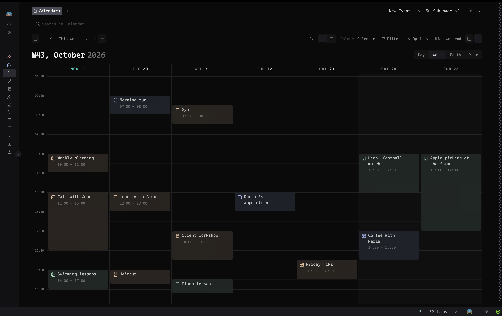
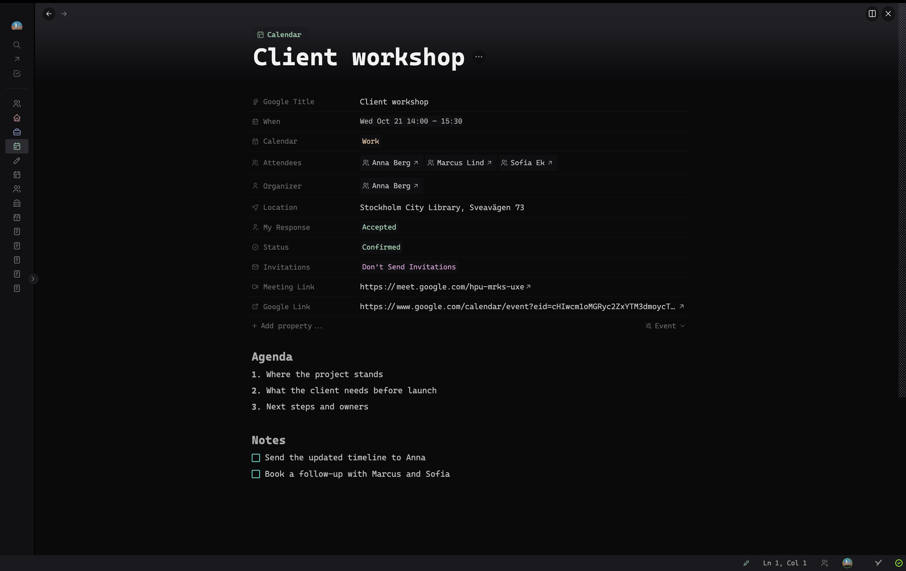
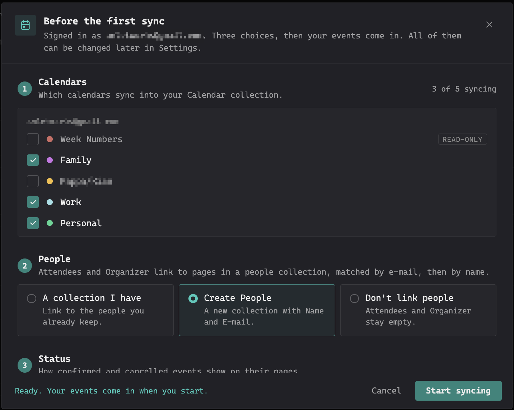
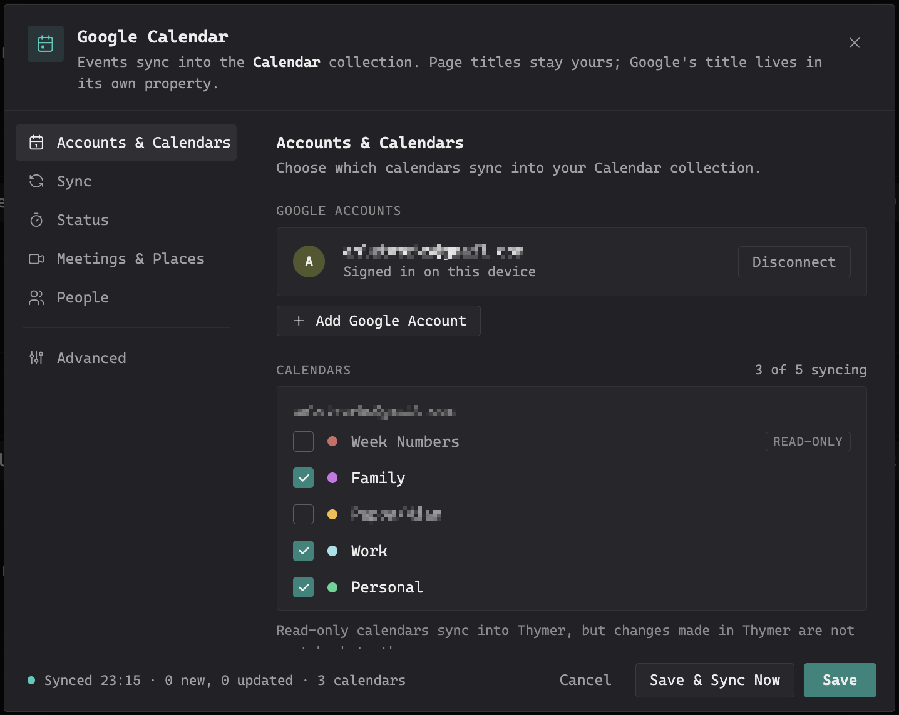
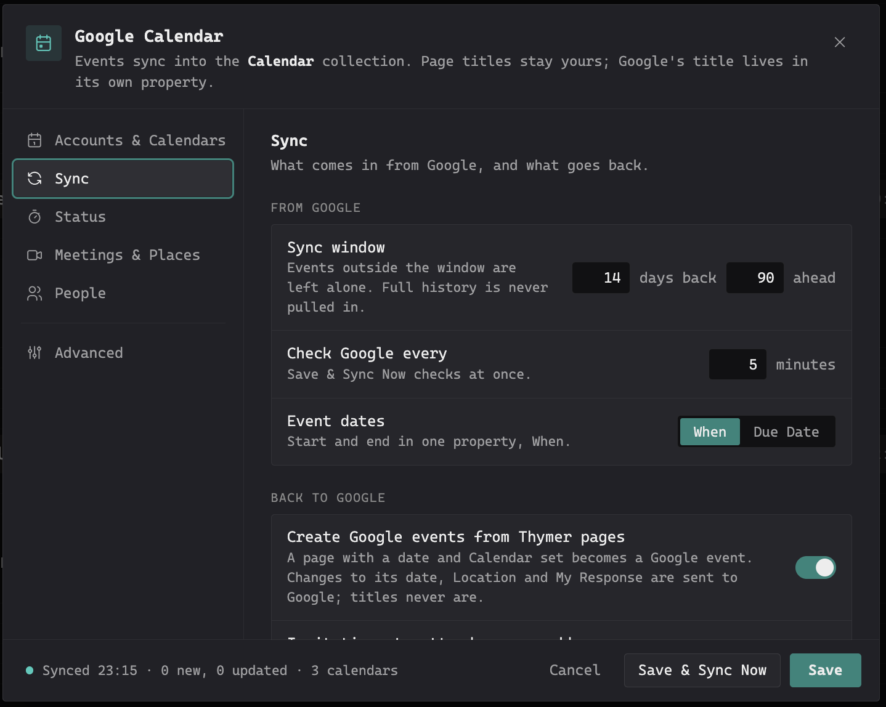
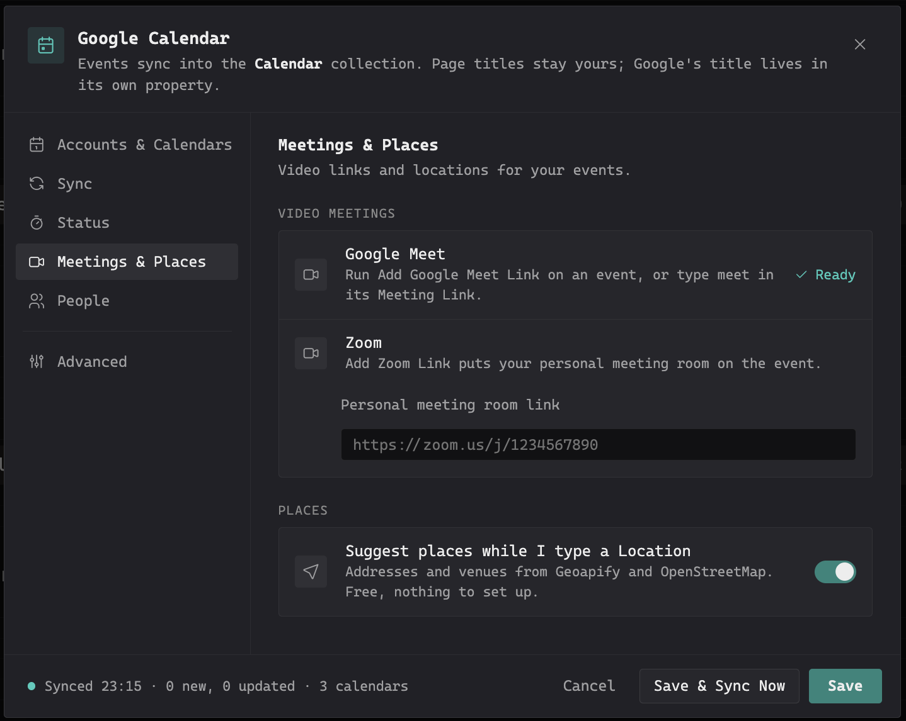

# Google Calendar

Google Calendar is a [Thymer](https://thymer.com) plugin that keeps your Google calendars and a Thymer collection in two-way sync. Every event becomes a page you can write in, link and tick off, and the changes you make in Thymer go back to Google.

*The week above is shown in the calendar view of the Timer plugin; the events, colours and pages come from Google Calendar.*

## What it does

- **Events become pages** in a collection called Calendar, with the event's date, Location, Attendees, Organizer, My Response and a link back to Google. The event's description lands in the page body once, when the page is created.
- **Dates in When or Due Date**: the date lives in one property, When by default. Choose Due Date instead (Settings, Sync, Event dates) to share the name your other collections and the Supertask plugin use, so a page you move to another collection keeps its date. Switching moves the dates of every page across.
- **Your page title is yours.** Google's title is kept in its own Google Title property, and the page title only follows Google while you have not renamed it.
- **Changes go back to Google**: the date, Location and My Response. A page you create yourself becomes a Google event once it has both a date and Calendar set; a page with only a date stays in Thymer.
- **Move a page out and it is yours**: a page you move to another collection leaves the sync. It keeps what it has, the sync stops changing it, and the event is not created again in Calendar. Move it back and it follows Google again.
- **Attendees link to your people** collection, matched by e-mail first, then by name. People who are not there yet get a page (optional), and a person page you trash is never created again.
- **Status**: cancelled events are marked, never deleted. You can map Google's confirmed and cancelled onto your own status collection (for example In Progress and Dropped), so events can be ticked off like tasks. A status you set yourself, like Done, is never overwritten.
- **Series edits move pages** instead of duplicating them, so notes on a recurring event survive "this and following" changes in Google.
- **Meeting links**: *Add Google Meet Link* creates a real Meet link on the event; *Add Zoom Link* adds your personal meeting room.
- **Place suggestions**: while you type a Location, addresses and venues appear below the field (Geoapify, with OpenStreetMap's Photon as a fallback). Pick one with the arrow keys and Enter, or the mouse; Enter without a pick keeps what you typed. Free, no key, and it can be switched off.
- **Several Google accounts**, each with its own choice of calendars, and a rolling sync window (a few days back, a few months ahead). Full history is never pulled in.

The plugin never deletes anything in Google. Trashing a page in Thymer leaves the Google event alone.

## Installation

1. In Thymer, open the Command Palette (`Cmd+P` / `Ctrl+P`), run **Plugins**, and click **Create Plugin** under Global Plugins.
2. In the plugin's dialog, go to the code editor (click **Edit as Code** if you see the settings view).
3. In the **Custom Code** tab, replace the contents with [`plugin.js`](plugin.js).
4. In the **Configuration** tab, replace the contents with [`plugin.json`](plugin.json).
5. Click **Save**.

## Getting started

1. Run **Google Calendar: Settings** from the Command Palette.
2. Click **Connect Google** and sign in. Your browser opens Google's sign-in and hands you back to Thymer afterwards.
3. **Before the first sync** asks three things: which calendars to sync, where attendees should link (a people collection you have, a new People collection, or none), and how status is shown. Click **Start syncing**. The Calendar collection is created on the first sync.

Sign-in is per device and per workspace: on another computer, open the settings there and sign in once.

## Settings

- **Accounts & Calendars**: connected accounts and the calendars to sync. Read-only calendars sync into Thymer, but changes are not sent back to them.
- **Sync**: the sync window, how often to check Google, where event dates go (When or Due Date), whether pages made in Thymer become Google events, and whether attendees you add get e-mail invitations (one event can differ through its Invitations property).
- **Status**: the built-in Confirmed/Cancelled choice, or your own status collection.
- **Meetings & Places**: your personal Zoom room link, and place suggestions on or off.
- **People**: the collection attendees link to, its e-mail property, and whether missing people get a page.
- **Advanced**: use your own Google Cloud OAuth client instead of the built-in one.

| Accounts & Calendars | Sync | Meetings & Places |
|---|---|---|
|  |  |  |

## Privacy

Calendar data travels only between your device and Google, and your sign-in tokens are stored on your device. Sign-in requests (connecting an account, and renewing the sign-in about once an hour) go through a small relay on Cloudflare Workers that adds the app's Google client credential; it stores and logs nothing, and calendar data never passes through it. Place suggestions send what you type in Location to Geoapify (api.geoapify.com), or to OpenStreetMap's Photon search (photon.komoot.io) when Geoapify is unavailable. It asks Google for two permissions: to view and edit events on your calendars, and to see the list of your calendars. Privacy policy: <https://calendar.anlet.se/privacy/>

## Feedback

Ideas, questions and bug reports are very welcome in [Issues](../../issues).

## Support

Google Calendar is free. If it has earned a place in your workspace and you would like to say thanks, you can [buy me a coffee](https://buymeacoffee.com/parhamshafti).

## License

All rights reserved. You may install and use the plugin for free; you may not modify it, redistribute it or build on its code. See [LICENSE](LICENSE).
